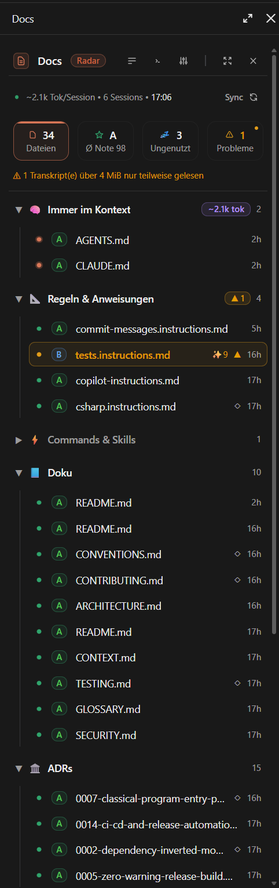
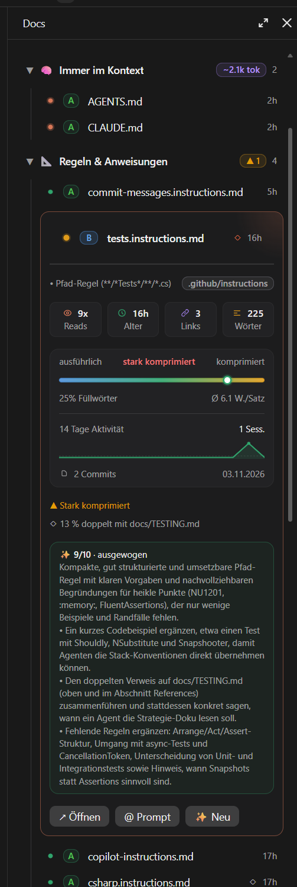

<div align="center">


# Doc Radar

**See which Markdown files Claude actually reads, what they cost, and which ones have gone bad.**

A sidebar mod for [Claude Code](https://claude.com/claude-code) that maps every Markdown file
of your project by how it reaches Claude, how often it is used, and how well it is written.

[](https://code.claude.com/docs)
[](.claude-plugin/plugin.json)
[](LICENSE)
[](#-privacy)

<br>


&nbsp;&nbsp;


<sub>The sidebar in the Claude desktop app: the overview, and a file opened with its AI review.</sub>

</div>

---

## Why

A project built with coding agents collects a lot of Markdown: a `CLAUDE.md` / `AGENTS.md`
chain, path rules, slash commands, skills, guides, ADRs, templates and Claude's own memory.
The file tree tells you none of this:

- 👁 **which files Claude really reads**, and which nobody has opened in weeks;
- 🧠 **what the always-loaded chain costs** in tokens, every single session;
- ⚠️ **which files have gone bad**: broken links, leftover TODOs, orphans, copies of another
  file, text squeezed into keywords, or a memory index too long to load whole.

Doc Radar answers that at a glance and points you to where to look first. It never changes a
file: you decide what to do, or hand the problems to Claude with one click.

## 🚀 Install

At the prompt of a Claude Code terminal session:

```
/plugin install doc-radar --marketplace SteffenMangold/Claude-DocRadar
```

From a shell:

```bash
claude plugin install doc-radar --marketplace SteffenMangold/Claude-DocRadar
```

Answer `y` to add the marketplace, then pick a scope (the user scope is first). In the **desktop
app**, where `/plugin` does not run: click **+** next to the prompt box, then **Plugins**,
**Add marketplace** with `SteffenMangold/Claude-DocRadar`, then **Add plugin**.

The sidebar opens with the next session. `/doc-radar` opens it at any time and scans at once.

> Built and tested on Claude Code 2.1.309. The interface is in German; where this README names
> something on screen, the German label follows in parentheses.

## 🧭 What you see

| Part | What it does |
|---|---|
| **Title bar** | ☰ tree or one list by last use · ›_ every problem into the prompt as a task for Claude · ⚙ settings · ⤢ open or close all groups · ✕ close |
| **Telemetry** | Tokens the always-loaded files cost per session, sessions found, time of the last scan, **Sync** to rescan |
| **Tiles** | Files (Dateien), average grade (Ø Note), unused (Ungenutzt), problems (Probleme). Each one filters the list |
| **Tree** | 🧠 Always in context · 📐 Rules & instructions · ⚡ Commands & skills · 📘 Docs · 🏛️ ADRs · 📋 Templates · 💾 Memory & Trim State |
| **Rows** | Usage dot, grade chip A–D, name, ✨ AI score, ▲ problem / ◇ hint, time since last use. Hover for a card with the facts |
| **File card** | Reads, age, inbound links, words · a compression scale from wordy to compressed · a 14-day activity line · git history · problems and hints · **Open**, **@ Prompt**, **✨ AI review** |
| **Footer** | Version, **Search** (Suche) by path, **Auto-Scan** on or off |

<details>
<summary><b>The usage dots</b></summary>

| Dot | Means |
|---|---|
| orange, glowing | always loaded |
| amber | has a problem: worth a look |
| green | used in the last 14 days |
| grey | used before that (the row is dimmed) |
| amber ring | only written by Claude, never read |
| grey ring | never used (the row is dimmed) |

</details>

The sidebar follows the desktop app's own look, its theme colours, font and buttons, in light
and dark mode. A terminal draws the same layout with glyphs.

## 📏 How it measures

**Usage** comes from the Claude Code transcripts of the project under
`~/.claude/projects/<project>/`, subagents and worktrees included: `Read` calls, shell commands
that only read (`cat`, `grep`, `rg`, `Get-Content`, `git show` …), `@`-mentions, slash commands,
skills and subagents, edits counted apart, and every session that loaded an always-loaded file.
The parsed facts are cached, so the history survives when old transcripts are cleaned up.

**Quality** starts at 100 points per file. Problems (▲) are worth fixing; hints (◇) are matters
of style. Grades: **A** ≥ 85 · **B** ≥ 70 · **C** ≥ 55 · **D** below.

<details>
<summary><b>Every problem and hint, with its points</b></summary>

| Problem ▲ | Points |
|---|---|
| Broken relative link | −8 each, at most −30 |
| `TODO`, `TBD`, `FIXME`, `XXX`, "lorem ipsum", "coming soon" (not in templates or commands) | −4 each, at most −20 |
| Heavily compressed | −15 |
| 30 % or more duplicated from another file | −15 |
| Orphaned: nothing links to it, and it is no entry point | −10 |
| Memory file the memory index does not list | −10 |
| Memory index over 200 lines or 25 KB: the rest is not loaded | −15 |
| Always-loaded file above ~4,000 tokens | −10 |

| Hint ◇ | Points |
|---|---|
| No H1 title (docs, READMEs, ADRs, agent files) | −8 |
| Very short: under 60 words, 120 for an ADR, 15 for a memory file | −15 |
| Dense writing | −5 |
| Wordy, long sentences | −8 |
| A section over 700 words with no heading | −8 |
| 12–30 % duplicated from another file | −6 |
| Unchanged for over a year (not ADRs) | −8 |

Templates are skeletons by design: no penalty for length, title or style. Links inside code
blocks and HTML comments are ignored, and so are placeholders inside code blocks.

</details>

**Compression** weighs four signals of the prose (code blocks excluded): the share of function
words ("the", "and", "der", "und"), words per sentence or list item, symbols per 100 words
(`→`, `=>`, `≥` …) and the share of bullet lines. Text squeezed into keyword lists saves tokens
but loses the words that carry meaning between the keywords; the scale shows where a file sits
between wordy, balanced and compressed.

**Memory index.** Claude Code loads the first 200 lines or 25 KB of `MEMORY.md`, whichever comes
first, after dropping front matter and HTML comment blocks
([docs](https://code.claude.com/docs/en/memory)). Doc Radar measures the index the same way and
checks that it points to every memory file: the Memory branch shows `clean` or what to trim.

**AI review**, on request, sends one file (up to 60,000 characters) to Claude Sonnet for a
score out of 10, a verdict on its compression and up to three tips. Reviews are kept per
project and marked outdated once the file changes.

## ⚙️ Settings

Kept across projects, behind ⚙ in the title bar:

| Setting | Default | Effect |
|---|---|---|
| Auto-Scan | on | Rescan after Claude's file changes and turns; off, only on **Sync** |
| Open at start (Beim Start öffnen) | on | Open the sidebar with every session |
| Show hints (Hinweise ◇ zeigen) | on | Show the ◇ hints beside the ▲ problems |

## 🔒 Privacy

Everything runs on your machine: the project files, `git`, and the transcripts in your Claude
config folder. Nothing is sent anywhere unless you press **✨ AI review**, which sends that one
file to the model. The mod's own store keeps the parsed transcript facts, the AI reviews, the
open or closed groups and the settings.

## ⚠️ Limits

- The scores are heuristics: a low grade means "look here", not "this file is wrong".
- Usage covers only Claude Code sessions on this machine.
- Up to 600 files are scanned and 250 rows drawn; the sidebar says when it leaves any out.
- The desktop side panel is 280 to 640 px wide; the layout is drawn for about 460 px, so drag
  its edge wider for the intended look.
- A mod cannot bind a key such as Ctrl+K in the desktop app: search opens from the footer.

## 🛠 Development

```
.claude-plugin/plugin.json        manifest
.claude-plugin/marketplace.json   makes this repository a marketplace
hooks/register.tsx                hooks: pane, /doc-radar, settings, scan scheduling, actions
hooks/scan.ts                     file list, git, transcripts, usage, memory index, verdicts
hooks/analyze.ts                  pure Markdown analysis and scoring
hooks/review.ts                   the AI review
hooks/view.tsx                    the sidebar's drawing
types/index.d.ts                  data types and the state contract
tests/doc-radar.test.tsx          tests
```

Run a working copy with `claude --plugin-dir <this folder>`, and check it with:

```bash
claude plugin validate .
```

```bash
claude plugin test .
```

## 📄 License

[Apache License 2.0](LICENSE)
